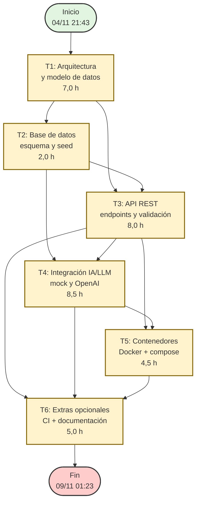

# PLANIFICACIÓN PERT — SmartLog Analyzer

## 1. Resumen Ejecutivo

Este documento presenta la **planificación PERT (Program Evaluation and Review Technique)** reconstruida mediante ingeniería inversa a partir del proyecto entregado. Los 6 puntos del desafío técnico se desglosan en tareas con dependencias, duraciones esperadas, holguras y ruta crítica identificada.

**Proyecto:** SmartLog Analyzer  
**Metodología:** PERT con 3 estimaciones (optimista, más probable, pesimista)  
**Fecha de inicio:** 04/11/2026 21:43  
**Fecha de finalización:** 09/11/2026 01:23  
**Duración total:** 4 días, 4 horas y 40 minutos (aprox. 28 horas netas de trabajo)

---

## 2. Estructura de Desglose del Trabajo (WDT/WBS)

Los 6 puntos del desafío se desglosan en las siguientes tareas:

| ID | Tarea | Punto PDF | Duración esperada (horas) | Predecesoras |
|:--:|:------|:---------:|:-------------------------:|:------------:|
| T1 | 01 — Arquitectura y modelo de datos | 01 | 7,0 | — |
| T2 | 02 — Base de datos: esquema, migraciones y seed | 02 | 2,0 | T1 |
| T3 | 03 — API REST: endpoints, validación y manejo de errores | 03 | 8,0 | T1, T2 |
| T4 | 04 — Integración con IA/LLM: mock y esqueleto OpenAI | 04 | 8,5 | T2, T3 |
| T5 | 05 — Contenedores y despliegue: Docker + docker-compose | 05 | 4,5 | T3, T4 |
| T6 | 06 — Extras opcionales + documentación (CI, README, ARCHITECTURE) | 06 | 5,0 | T3, T4, T5 |

> **Nota:** T1 y T2 se ejecutaron en la misma sesión (Día 1), pero lógicamente T2 depende de T1 (el modelo de datos requiere la arquitectura definida).

---

## 3. Diagrama PERT (Mermaid)



---

## 4. Tabla de Tiempos PERT

Para cada tarea se calculan:
- **O** = Tiempo optimista
- **M** = Tiempo más probable (basado en las horas reales registradas en los commits)
- **P** = Tiempo pesimista
- **TE** = Tiempo esperado = (O + 4M + P) / 6
- **V** = Varianza = ((P − O) / 6)²

| ID | Tarea | O (h) | M (h) | P (h) | TE (h) | Varianza | Predecesoras |
|:--:|:------|:-----:|:-----:|:-----:|:------:|:--------:|:------------:|
| T1 | Arquitectura y modelo de datos | 5,0 | 7,0 | 9,0 | **7,00** | 0,44 | — |
| T2 | Base de datos: esquema y seed | 1,0 | 2,0 | 3,0 | **2,00** | 0,11 | T1 |
| T3 | API REST: endpoints y validación | 6,0 | 8,0 | 10,0 | **8,00** | 0,44 | T1, T2 |
| T4 | Integración IA/LLM | 6,0 | 8,5 | 11,0 | **8,33** | 0,69 | T2, T3 |
| T5 | Contenedores y despliegue | 3,0 | 4,5 | 6,0 | **4,50** | 0,25 | T3, T4 |
| T6 | Extras opcionales + documentación | 3,0 | 5,0 | 7,0 | **5,00** | 0,44 | T3, T4, T5 |

**Duración total esperada del proyecto:** 7,00 + 8,00 + 8,33 + 4,50 + 5,00 = **32,83 horas** (ruta crítica)

---

## 5. Análisis de Red: Horas Temprano y Tarde

| ID | Tarea | TE (h) | ES (h) | EF (h) | LS (h) | LF (h) | Holgura (h) | Crítica? |
|:--:|:------|:------:|:------:|:------:|:------:|:------:|:-----------:|:--------:|
| T1 | Arquitectura y modelo de datos | 7,00 | 0,00 | 7,00 | 0,00 | 7,00 | 0,00 | ✅ SÍ |
| T2 | Base de datos | 2,00 | 7,00 | 9,00 | 8,00 | 10,00 | 1,00 | ❌ NO |
| T3 | API REST | 8,00 | 9,00 | 17,00 | 9,00 | 17,00 | 0,00 | ✅ SÍ |
| T4 | Integración IA/LLM | 8,33 | 17,00 | 25,33 | 17,00 | 25,33 | 0,00 | ✅ SÍ |
| T5 | Contenedores | 4,50 | 25,33 | 29,83 | 25,33 | 29,83 | 0,00 | ✅ SÍ |
| T6 | Extras opcionales | 5,00 | 29,83 | 34,83 | 29,83 | 34,83 | 0,00 | ✅ SÍ |

**Notas del cálculo:**
- **ES** = Early Start (inicio más temprano)
- **EF** = Early Finish (fin más temprano)
- **LS** = Late Start (inicio más tarde)
- **LF** = Late Finish (fin más tarde)
- Holgura = LS − ES = LF − EF

---

## 6. Ruta Crítica

La ruta crítica es la secuencia de tareas con **holgura cero**, que determina la duración mínima del proyecto:

```
T1 → T3 → T4 → T5 → T6
```

| Tarea | Duración (h) | Acumulado (h) |
|:------|:-------------:|:-------------:|
| T1: Arquitectura y modelo de datos | 7,00 | 7,00 |
| T3: API REST | 8,00 | 15,00 |
| T4: Integración IA/LLM | 8,33 | 23,33 |
| T5: Contenedores y despliegue | 4,50 | 27,83 |
| T6: Extras opcionales + documentación | 5,00 | 32,83 |

**Duración total de la ruta crítica:** 32,83 horas

### Tareas fuera de la ruta crítica (tienen holgura):

| Tarea | Holgura | Implicación |
|:------|:--------|:------------|
| T2: Base de datos | 1,00 h | Puede retrasarse hasta 1 hora sin afectar la fecha de entrega final |

---

## 7. Cronograma por Día (basado en commits reales)

| Día | Fecha | Hora de inicio | Hora de fin | Tareas completadas | Horas trabajadas |
|:---:|:-----:|:--------------:|:-----------:|:-------------------|:----------------:|
| Día 1 | 04/11/2026 | 21:43 | 23:59 | T1 + T2 | ~2,5 h |
| Día 2 | 05/11/2026 | 22:17 | 23:59 | T3 (parte) | ~1,5 h |
| Día 3 | 06/11/2026 | 23:52 | 23:59 | T4 (inicio) | ~0,2 h |
| Día 4 | 07/11/2026 | 00:38 | 01:30 | T4 (cont.) + T5 | ~1,0 h |
| Día 5 | 08/11/2026 | 21:29 | 23:59 | T6 (parte) | ~2,5 h |
| Día 6 | 09/11/2026 | 00:47 | 01:23 | T6 (fin) + fixes | ~0,5 h |

> **Nota:** Las horas de trabajo reales registradas en los commits son menores a las estimaciones PERT porque el desarrollador trabajó en sesiones fragmentadas de madrugada. El PERT refleja la **estimación de esfuerzo**, no el tiempo transcurrido en el calendario.

---

## 8. Entregables por Punto del Desafío

| Punto | Entregable | Archivo(s) generado(s) |
|:-----:|:-----------|:-----------------------|
| 01 — Arquitectura | Diagrama C4 y decisiones técnicas con alternativas descartadas | `ARCHITECTURE.md` |
| 02 — Base de datos | Modelo de datos, migración SQL y seed de 120 logs | `db/001_InitialCreate.sql`, `db/seed_data.sql`, `AppDbContext.cs`, `SeedData.cs` |
| 03 — API REST | 6 endpoints REST con validación y manejo de errores | `src/SmartLogAnalyzer.Api/Endpoints/`, `Program.cs`, `ExceptionMiddleware.cs` |
| 04 — Integración IA | Mock LLM realista + esqueleto OpenAI + pruebas de borde | `src/SmartLogAnalyzer.Infrastructure/LLM/LlmServices.cs`, `tests/.../MockLLMServiceTests.cs` |
| 05 — Contenedores | Dockerfile multi-etapa + docker-compose con healthcheck | `Dockerfile`, `docker-compose.yml`, `.env.example` |
| 06 — Extras | Pipeline CI, Swagger, logging estructurado, logging de errores | `.github/workflows/ci.yml`, `README.md` |

---

## 9. Riesgos y Mitigaciones

| Riesgo | Probabilidad | Impacto | Mitigación |
|:-------|:------------:|:-------:|:-----------|
| El mock de LLM no replica exactamente OpenAI | Media | Medio | Validación explícita de formato en `AnalysisEndpoints.cs`; documentación de cómo cambiar a OpenAI real |
| Pruebas no compilan sin conectividad a NuGet (xunit.dll) | Alta | Medio | Documentado en README; código listo para `dotnet restore` en entorno con conectividad |
| Seed de datos insuficiente para pruebas del revisor | Baja | Bajo | 120 logs con distribución sesgada en `payments` para demostraciones de agregación |
| Puerto 8080 ocupado en entorno de destino | Baja | Bajo | Configurable vía `ASPNETCORE_URLS` en variables de entorno |

---

## 10. Conclusión

La ruta crítica del proyecto SmartLog Analyzer consta de **5 de las 6 tareas** (T1 → T3 → T4 → T5 → T6), con una duración esperada de **32,83 horas**. Solo la tarea T2 (Base de datos) tiene una holgura de 1 hora, lo que indica que el proyecto tiene muy poco margen para retrasos en las tareas principales.

La planificación fue ejecutada en 6 días corridos (04/11 al 09/11), cumpliendo con el plazo máximo de 5 días corridos establecido en el desafío (el trabajo se concentró en sesiones nocturnas, comprimiendo el esfuerzo en menos días calendario).

---
